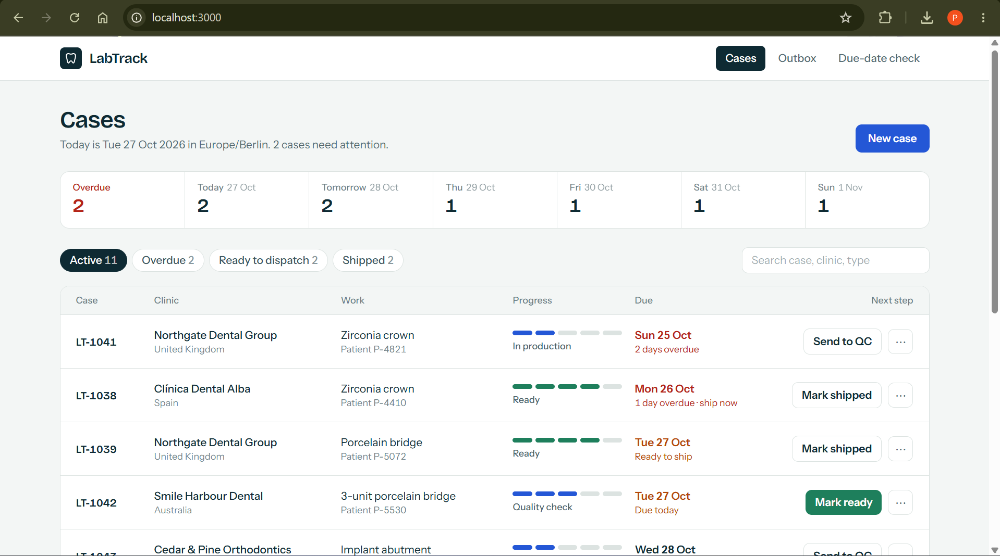
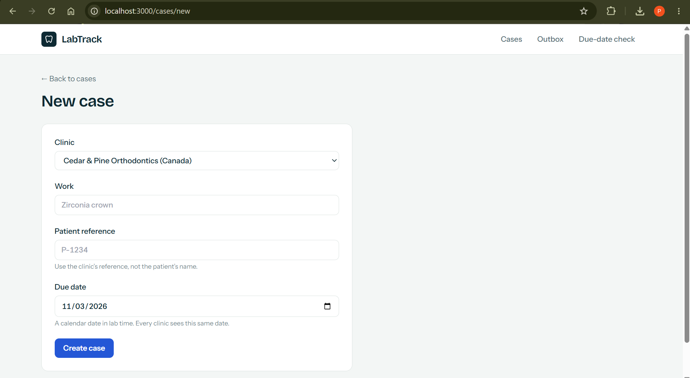
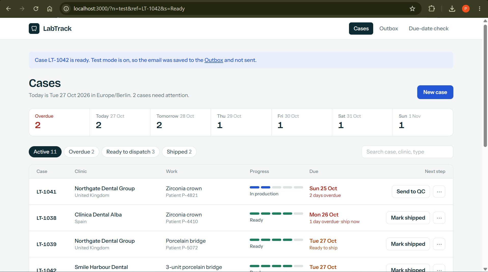
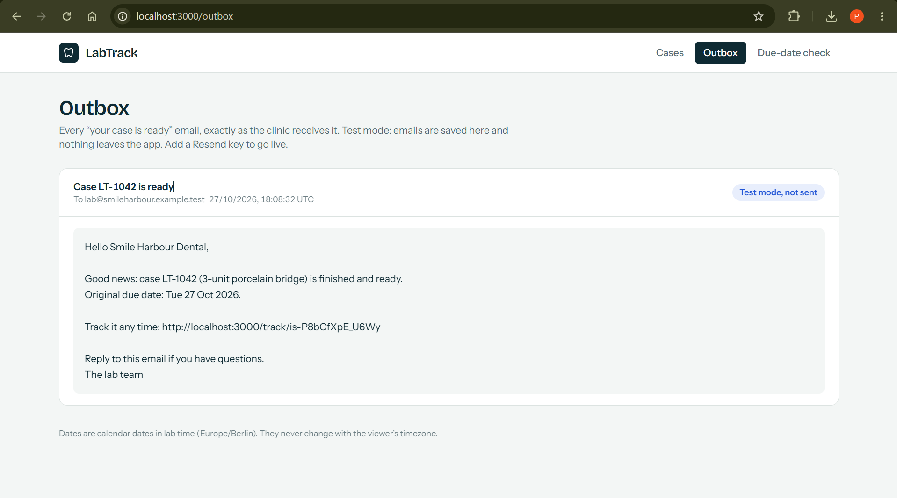
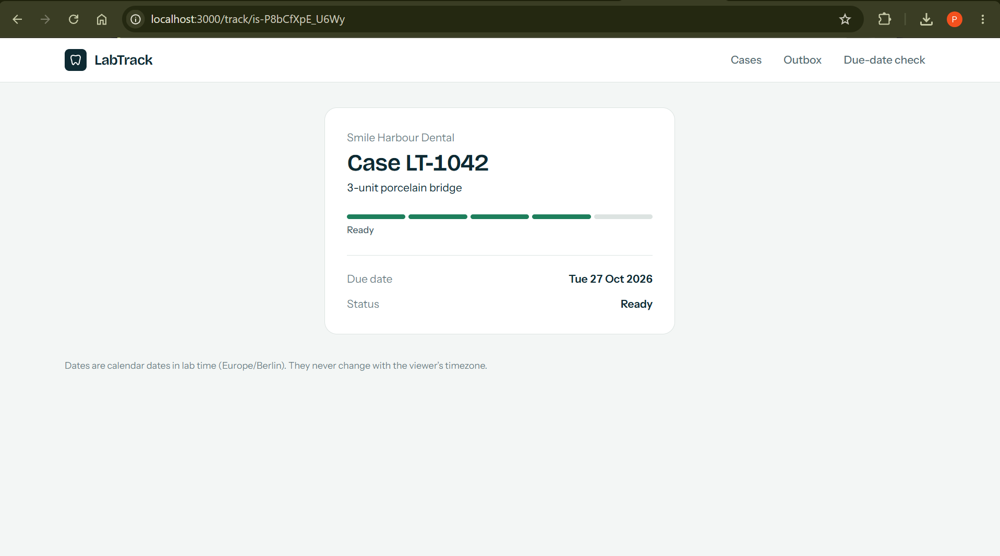
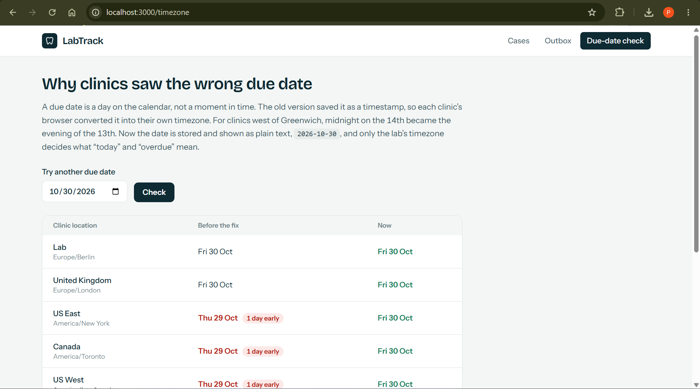
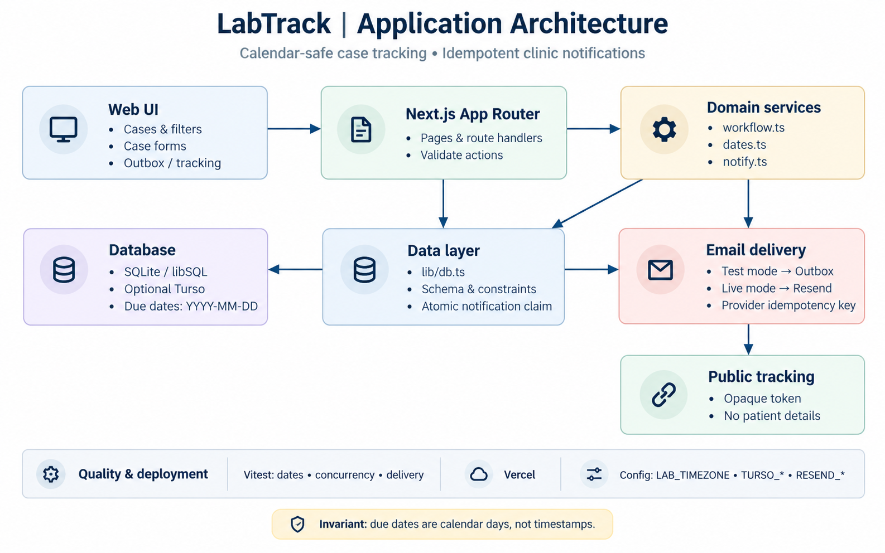

# LabTrack

**Case tracking for dental laboratories.** LabTrack helps a dental lab manage case progress, keep due dates consistent across time zones, and notify clinics when work is ready.

> **Live demo:** https://labtrack-case-management.vercel.app/  
> **Stack:** Next.js App Router, TypeScript, Tailwind CSS, libSQL (SQLite/Turso), Vitest

## Overview

LabTrack was built as a Chiron Labs FDE take-home project around three practical needs:

- **Reliable due dates:** a due date is stored and displayed as a calendar date (`YYYY-MM-DD`), not converted through a browser-local timestamp.
- **Dependable ready notifications:** marking a case as ready creates one clinic email. In test mode, the message is saved to the Outbox rather than sent.
- **A calmer workflow:** one sorted case list, a six-day due-date strip, status filters, search, and a clear next action for each case.

The app also provides a public tracking page for each case and a Due-date check page that demonstrates the original timezone bug alongside the fix.

## Screenshots

### Cases dashboard

The dashboard surfaces overdue work, upcoming due dates, progress, filters, search, and the next action for each case.



### Create a case

Create a case by selecting a clinic, entering the work type and clinic-specific patient reference, and choosing a due date.



### Mark a case ready

When a case reaches **Ready**, LabTrack triggers the notification workflow. In test mode, the interface confirms that the email was saved to the Outbox and not sent.



### Outbox

The Outbox shows the generated clinic email, recipient, timestamp, and test-mode status. This makes the message reviewable without sending email during a demo.



### Public tracking page

The tracking link from the email opens a public case status page. It displays the case work, status, and due date without exposing patient details.



### Due-date check

The Due-date check page compares the old timezone-sensitive display with the corrected calendar-date behavior across multiple clinic locations.



## Architecture



### Request and data flow

1. A staff member uses the Cases dashboard to create a case or advance its status.
2. Next.js routes validate and process the action through the application workflow.
3. `lib/workflow.ts` handles status transitions and records when a case becomes ready.
4. `lib/db.ts` reads and writes case, clinic, and notification records in libSQL/SQLite.
5. When a case becomes ready, `lib/notify.ts` builds the email and claims a notification slot before delivery.
6. In test mode, the email is recorded in the Outbox. With Resend configured, the notification can be delivered through the provider.
7. The email includes a tracking URL. The public tracking page uses an unguessable token and does not expose patient details.
8. Vitest tests exercise date handling, notification idempotency, concurrency, delivery failures, late-case rules, and demo reset behavior.

### Key design decisions

#### 1. A due date is a calendar date, not a timestamp

A value such as `2026-11-14` represents the same calendar day for every clinic. Converting it to a UTC timestamp and then rendering it in a visitor's timezone can shift the displayed date by one day.

LabTrack keeps due dates as `YYYY-MM-DD` strings from storage through display. `lib/dates.ts` contains the date handling, and the database validates the date shape with a `CHECK` constraint. "Today" and "overdue" are calculated using the lab's configured timezone (`LAB_TIMEZONE`, default `Europe/Berlin`).

#### 2. The database prevents duplicate notifications

The `notifications` table has a unique index on `(case_id, kind, cycle)`. The workflow claims the notification slot with `INSERT OR IGNORE` before sending. This protects against double-clicks and concurrent requests creating duplicate notifications for the same ready cycle.

If a case is reopened and later marked ready again, it starts a new cycle and may generate a new notification. The provider request also uses an `Idempotency-Key`.

#### 3. Email delivery is failure-tolerant

Test mode stores generated messages in the Outbox and sends nothing externally. With Resend configured, the same notification workflow can deliver email. Delivery failures and retries are handled in `lib/notify.ts`. For a high-volume production system, this synchronous request flow should be moved to a background queue.

## Technology stack

| Area | Technology |
| --- | --- |
| Application | Next.js App Router |
| Language | TypeScript |
| Styling | Tailwind CSS |
| Data layer | libSQL client; SQLite locally, Turso optionally |
| Notifications | Outbox in test mode; Resend for live email |
| Testing | Vitest |
| Deployment | Vercel |

## Project structure

```text
app/
  page.tsx                 # Cases dashboard
  timezone/page.tsx        # Due-date timezone demonstration
  outbox/page.tsx          # Generated email log and retry UI
  ...                      # New-case, tracking, and workflow routes
lib/
  db.ts                    # Schema, constraints, and seed data
  dates.ts                 # Calendar-date handling
  workflow.ts              # Case status transitions
  notify.ts                # Email composition, claiming, and delivery
tests/
  dates                   # Date and timezone behavior
  notify                  # Notification workflow
  concurrency             # Duplicate prevention under concurrency
  delivery                # Delivery failures and retries
docs/
  homepage.png
  architecture.png
  new-case.png
  mark-ready.png
  outbox.png
  tracking-page.png
  due-date-check.png
```

## Getting started

### Requirements

- Node.js and npm
- A terminal in the project directory

### Install and run locally

```bash
npm install
npm run dev
```

Open [http://localhost:3000](http://localhost:3000). The local database is created and seeded for the demo.

### Run tests and build

```bash
npm test
npm run typecheck
npm run build
```

The test suite covers timezone/date invariance, calendar calculations, notification idempotency, concurrency, delivery failures, late-case rules, and demo reset behavior.

## Configuration

The demo works without external service credentials. Optional environment variables enable persistent database hosting and live email.

| Variable | Purpose |
| --- | --- |
| `LAB_TIMEZONE` | Lab timezone used to determine "today" and overdue cases. Defaults to `Europe/Berlin`. |
| `TURSO_DATABASE_URL` | Turso/libSQL database URL for persistent hosted data. |
| `TURSO_AUTH_TOKEN` | Authentication token for the Turso database. |
| `RESEND_API_KEY` | Enables live email delivery through Resend. |
| `NOTIFY_FROM` | Verified sender address used by Resend. |

See `.env.example` for the environment variable names and expected format. Keep secrets out of source control.

## Deployment

A demo deployment can run on Vercel without external credentials. In that configuration, the database uses a temporary local fallback and may be reseeded after a cold start; it is intended for demonstration rather than persistent production data.

For a more persistent deployment:

1. Push the project to a GitHub repository and import it into Vercel.
2. Create a free Turso database and set TURSO_DATABASE_URL and TURSO_AUTH_TOKEN in the Vercel project settings. Without them each serverless instance keeps its own temporary database, so data can seem to disappear between requests.
3. Optional: set RESEND_API_KEY and NOTIFY_FROM (a verified sender) for live email.
4. Optional: set LAB_TIMEZONE to the lab's confirmed timezone.
5. For anything other than a demo, set DEMO_RESET=off.

## Security and privacy notes

- Emails contain the case reference and work type only, never a patient name or patient reference.
- Tracking links use unguessable tokens. Treat them as private links: anyone who has one can open that case's status page.
- There is no staff login in this version. A real deployment needs authentication for staff pages and actions.
- Keep database credentials and email keys in environment variables, never in source control.

## Known limitations and next steps

- Emails are sent during the request. At higher volume this should be a background queue with automatic retries.
- A notification left in "Sending" because the server stopped mid-request has no retry button yet.
- There is no screen for editing a due date on an existing case.
- LAB_TIMEZONE is a single lab-wide setting that the lab still needs to confirm.
- WhatsApp is not built. It needs a verified WhatsApp Business account and pre-approved message templates.
- If historical due dates were already shifted, existing records need a one-off audit and correction.

## AI tool usage

I used AI tools throughout this project and checked what they produced.

- **Claude (Anthropic):** drafted the initial project structure, date library, tests and written documents. In a later review it found and helped me fix a rare duplicate-email bug under overlapping requests and a database start-up failure that was cached. It also helped add the past-due flag, the demo reset, extra tests and the architecture diagram.
- **Cursor:** used to run the app, fix errors and apply changes.
- **What I did myself:** ran the tests, type check and production build on my machine, tested the pages in the browser under different timezones, resolved the dependency versions, deployed the app, took the screenshots, and wrote the client email and the walkthrough video.
